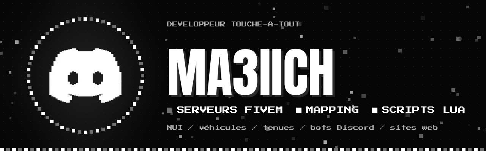
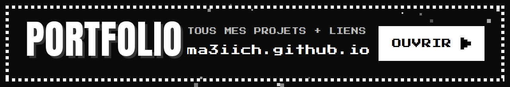
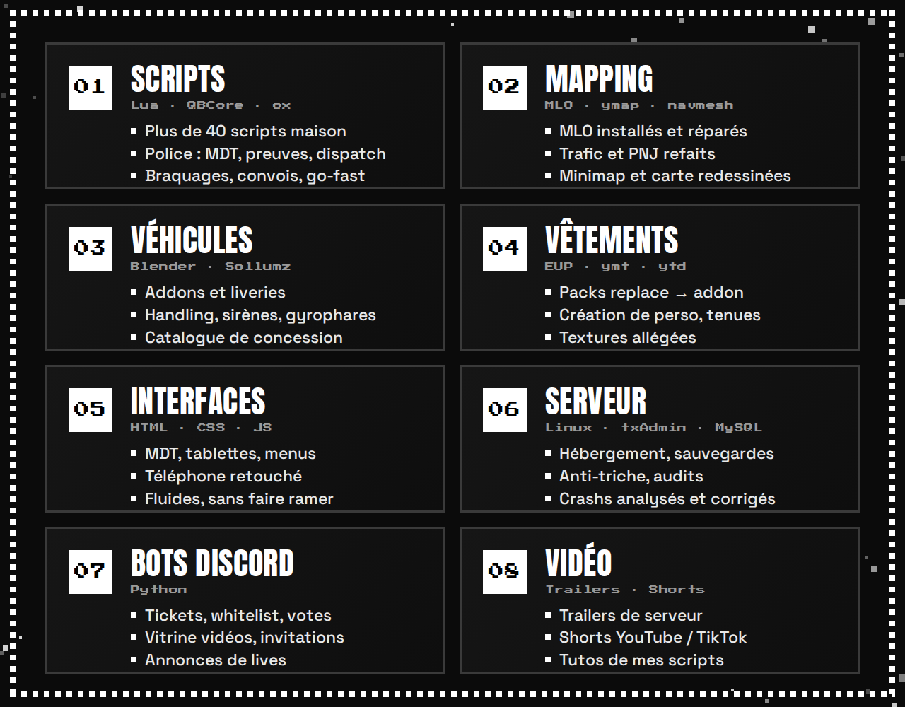
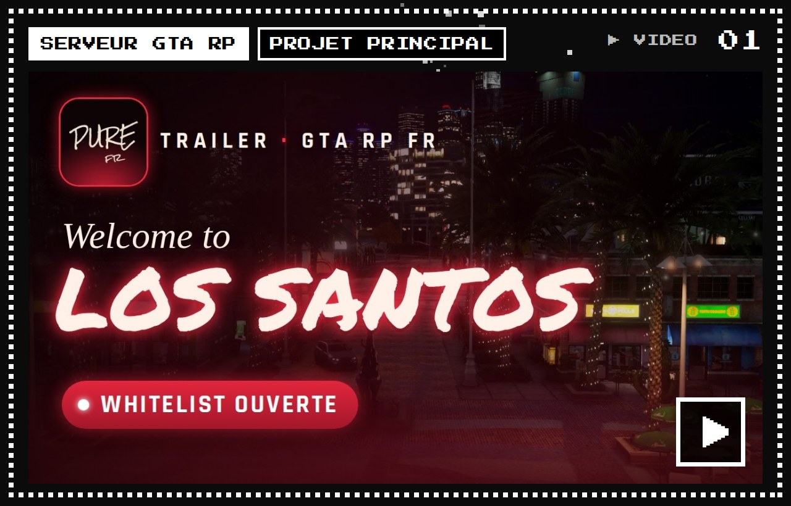
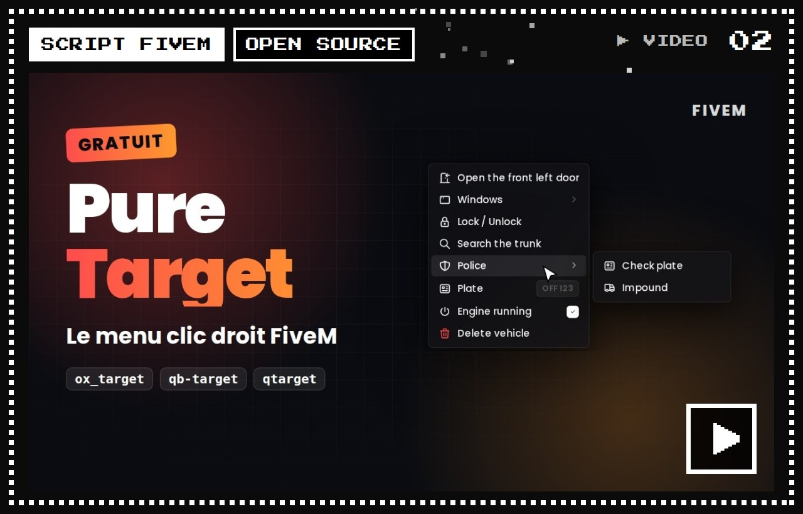
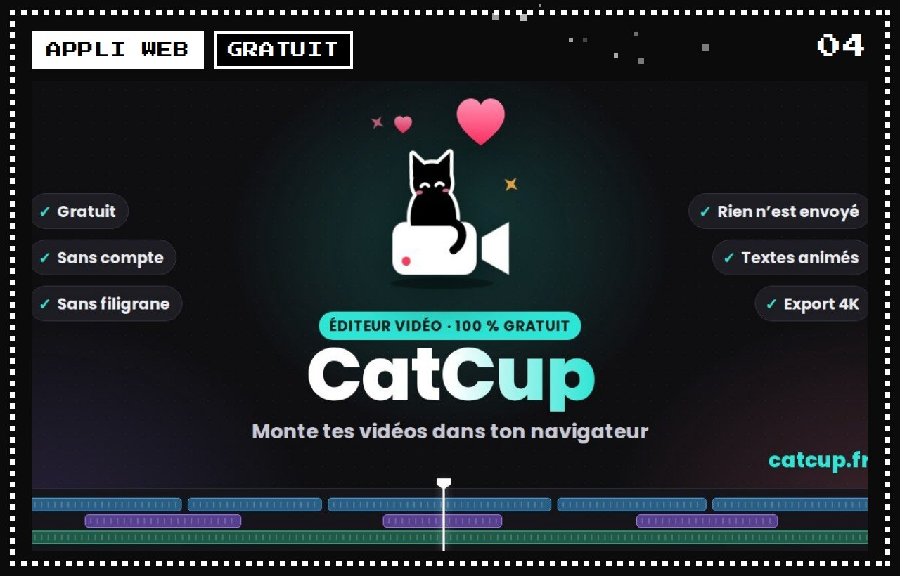
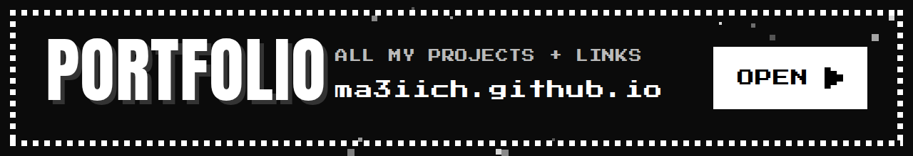
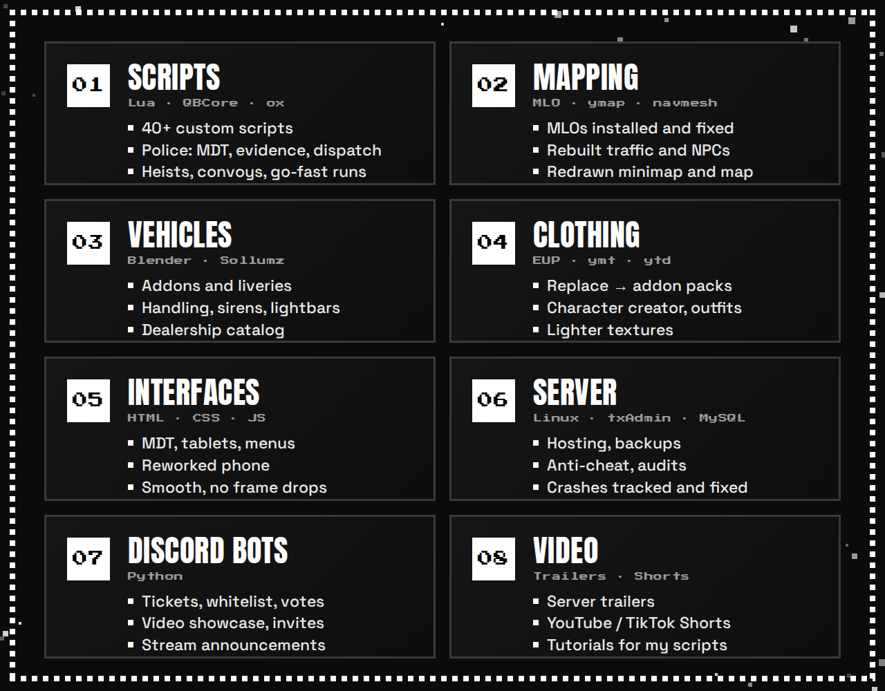
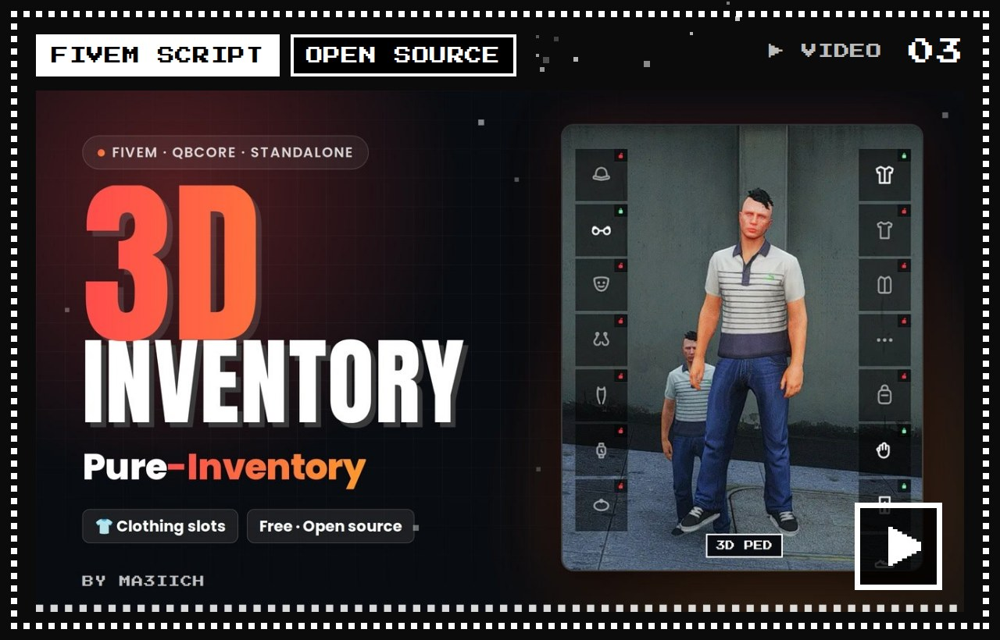
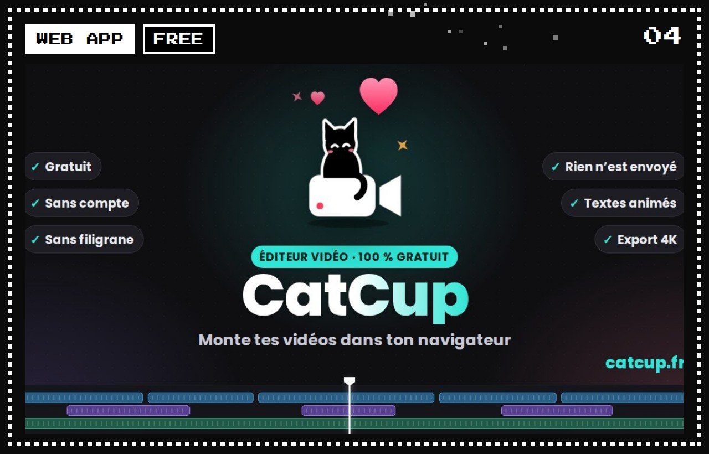

<picture></picture>

  

  

  
  

## 👋 Salut, moi c'est ma3iich

Développeur **touche-à-tout** : scripts, interfaces, sites web, bots Discord, montage vidéo…
Ces temps-ci, je suis surtout à fond dans les **serveurs FiveM** (GTA V roleplay), du **mapping** jusqu'aux **scripts**,
en passant par les véhicules, les vêtements, les interfaces et l'hébergement.

Mon gros projet du moment : **Pure**, un serveur GTA RP whitelist français que je construis de A à Z.

---

## 🎮 Ce que je fais sur FiveM

  

---

## 📦 Projets

### Pure

**Mon plus gros projet.** Un serveur GTA RP whitelist français que je construis de A à Z : maps, scripts, véhicules, vêtements, lore.

   

 

### Pure-Target

Menu de ciblage **clic droit** pour FiveM, open source. Remplace ox_target, qtarget et qb-target sans toucher à tes scripts. Standalone, 13 langues.

 

 

### Pure Inventory

Inventaire pour FiveM, open source : ton **perso en 3D**, des cases de vêtements, un rendu réglable. Standalone ou QBCore, marche avec Pure-Target.

 

 

### CatCup

**Éditeur vidéo** gratuit dans le navigateur, façon CapCut : sans compte, sans filigrane, rien n'est envoyé en ligne. Sous-titres auto, export 4K.

 

---

## 🛠️ Outils

  
  
  
  
  
  
  
  
  
  
  

  Une question, un projet FiveM ? Passe sur le <a href="https://discord.gg/73w9ZanWyv">Discord</a> 🤍

<picture></picture>

  

  

  
  

## 👋 Hi, I'm ma3iich

An **all-round developer**: scripts, interfaces, websites, Discord bots, video editing…
These days I'm mostly all-in on **FiveM servers** (GTA V roleplay), from **mapping** to **scripts**,
including vehicles, clothing, interfaces and hosting.

My big project right now: **Pure**, a French whitelisted GTA RP server I'm building from the ground up.

---

## 🎮 What I do on FiveM

  

---

## 📦 Projects

### Pure

**My biggest project.** A French whitelisted GTA RP server I'm building from the ground up: maps, scripts, vehicles, clothing, lore.

   

 

### Pure-Target

Open-source **right-click** targeting menu for FiveM. Replaces ox_target, qtarget and qb-target without touching your scripts. Standalone, 13 languages.

 

 

### Pure Inventory

Open-source inventory for FiveM: your **character in 3D**, clothing slots, an adjustable look. Standalone or QBCore, works with Pure-Target.

 

 

### CatCup

Free **video editor** in your browser, CapCut-style: no account, no watermark, nothing is uploaded. Auto subtitles, 4K export.

 

---

## 🛠️ Tools

  
  
  
  
  
  
  
  
  
  
  

  A question, a FiveM project? Drop by the <a href="https://discord.gg/73w9ZanWyv">Discord</a> 🤍

