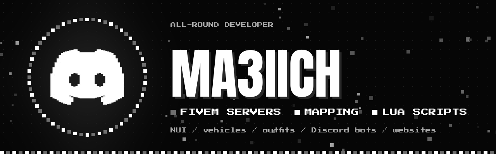

  
  

  

  
  
  

## 👋 Hi, I'm ma3iich

An **all-round developer**: scripts, interfaces, websites, Discord bots, video editing…
These days I'm mostly all-in on **FiveM servers** (GTA V roleplay), from **mapping** to **scripts**,
including vehicles, clothing, interfaces and hosting.

My big project right now: **Pure**, a French whitelisted GTA RP server I'm building from the ground up.

---

## 🎮 What I do on FiveM

<table>
<tr>
<td width="50%" valign="top">

### 🧩 Scripts (Lua · QBCore · ox)
- Over **40 custom scripts**: targeting menu, multi-player scenes, two-person revive, coma
- Police: full **MDT**, evidence (blood, fingerprints, UV light), handcuffs, radar, dispatch
- Activities: train heists, convoys, burglaries, go-fast runs, fishing, bag snatching
- Systems: payroll, wear and tear, lockers, schedules, server-side secured vehicle keys

</td>
<td width="50%" valign="top">

### 🗺️ Mapping
- Installing and fixing **MLOs / ymaps** (conflicts with the base map, collisions)
- Rebuilt **navmesh** and NPC traffic so neighborhoods feel alive
- Islands, prison, hospital, city hall, new districts, borders, fog zones
- **Redrawn minimap** and pause-menu map kept up to date with the mappings

</td>
</tr>
<tr>
<td valign="top">

### 🚓 Vehicles
- Addons, **liveries** (Blender + Sollumz), handling, sirens and lightbars
- Armed vehicles, cargo ramps, boat anchor, heli camera
- Dealership catalog with photos and performance bars

</td>
<td valign="top">

### 👕 Clothing & characters
- Converting **EUP packs from replace to addon**, handling the `.ymt` limits
- Character creation, appearance, outfits, inventory images
- Texture optimization to prevent freezes

</td>
</tr>
<tr>
<td valign="top">

### 🖥️ Interfaces (NUI)
- In-game HTML / CSS / JavaScript: MDT, tablets, menus, reworked phone
- Smooth interfaces designed not to slow the game down

</td>
<td valign="top">

### 🛡️ Server & security
- **Linux** hosting, txAdmin, **MySQL**, automatic backups
- Anti-cheat, security audits, **crash** analysis and fixes

</td>
</tr>
<tr>
<td colspan="2" valign="top">

### 📣 Community
**Discord bots** in Python (tickets, whitelist, votes, video showcase, stream announcements) · **trailers and shorts** edited for YouTube / TikTok · server page on the FiveM server list

</td>
</tr>
</table>

---

## 📦 Projects

| Project | Description |
|---|---|
| 🎯 [**Pure-Target**](https://github.com/ma3iich/pure-target) | Open-source right-click targeting menu for FiveM. Replaces ox_target, qtarget and qb-target. 13 languages. |
| 🎒 [**Pure Inventory**](https://github.com/ma3iich/pure_inventory) | Open-source inventory for FiveM: your character in 3D, clothing slots, an adjustable look. Standalone or QBCore, works with Pure-Target. |
| 🌴 [**Pure**](https://servers.fivem.net/servers/detail/zjjxbq9) | French whitelisted GTA RP server, built from the ground up: maps, scripts, vehicles, lore. [Discord](https://discord.gg/hpr7xwVqyf) · [YouTube](https://www.youtube.com/@PureRPFrance) |
| 🐱 [**CatCup**](https://catcup.fr) | Online video editor |
| 👕 [**Que Du Full**](https://quedufull.pages.dev) | Showcase website for a clothing store in Lille, France |
| 🔗 [**Portfolio**](https://ma3iich.github.io) | All my projects and links in one place |

---

## 🛠️ Tools

  
  
  
  
  
  
  
  
  
  
  

  A question, a FiveM project? Drop by the <a href="https://discord.gg/73w9ZanWyv">Discord</a> 🤍

